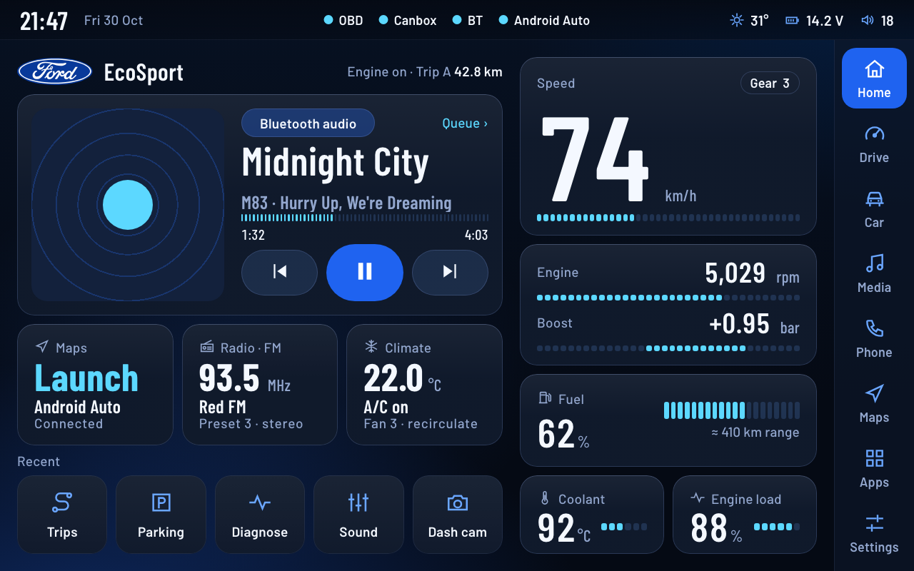
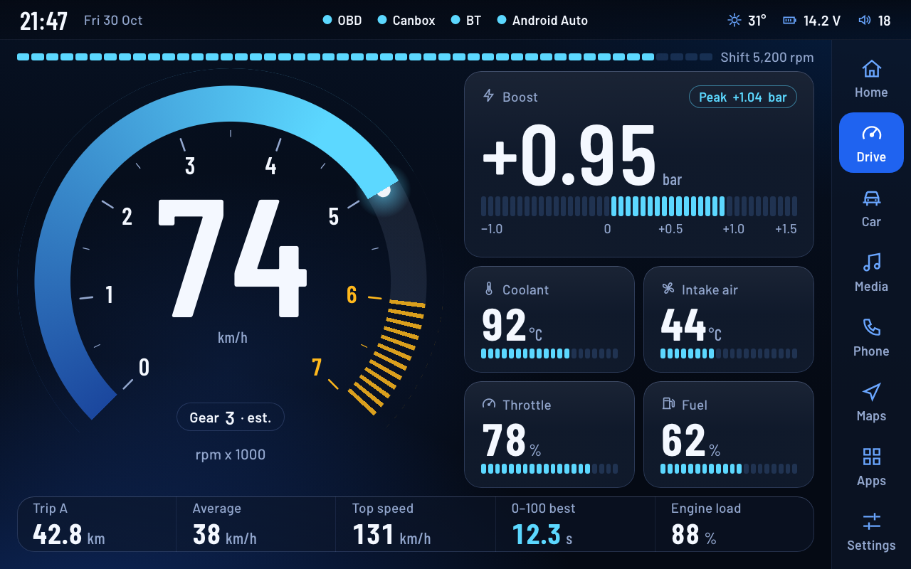

# Car-Interface (ecosport-cockpit)

A replacement launcher and live-vehicle dashboard for a **Blaupunkt Palm Bay 1000** Android head unit (1280x800, Android 11) in a **2015 Ford EcoSport 1.0 EcoBoost (India)**.

Dashboard values: RPM, speed, boost, coolant, battery, fuel and trip data. Vendor apps (radio, phone, camera, CarPlay / Android Auto, EQ) stay stock and are launched from the dock.

## Status

| Part | State |
| --- | --- |
| Research, plan, root assessment | Done (`docs/`) |
| Vehicle layer (`:vehicle`, pure Kotlin): ELM327 client, OBD parsers, simulator, read-only command guard | Done, 26 tests (1 needs the ELM327 emulator) |
| Canbox UART frame decoder (Python) | Done, 10 tests green |
| UI design site, 21 screens, two themes (Ford, default; Cockpit) | Done, in a recursive review loop (`docs/design/critique/`) |
| Compose app and on-unit frame metrics | Not started |
| Reading the real unit (Canbox dialect, adb) | Waiting on physical access |
| Root | Optional, last, and only after stock firmware recovery is proven |

Decisions: Kotlin + Jetpack Compose. Gate: per-frame cost p99 <= 10 ms with zero missed vsyncs, measured on the real unit. See `docs/PLAN.md` and `docs/PERF.md`.

## Safety model

The app is **read-only toward the car**: only ELM327 `AT` configuration commands and OBD-II Mode 01 reads are ever sent, enforced by `CommandGuard` and tests. It is not safety-certified; do not operate the display while driving.

## Try the design site

Needs Python 3 only. Google Chrome is needed just for the screenshot and QA helpers.

    tools/design.sh serve        # http://127.0.0.1:8750/prototype.html

Open `prototype.html` (interactive, press L for the live drive), `index.html` (overview), `design-system.html`, `components.html` or `specs.html`. Any single screen: `screens/<name>.html?raw=1[&theme=cockpit][&live=1]`.

## Develop

    python3 tools/design-check.py                      # links, registry, one-Ford-mark rule
    cd tools && python3 -m unittest test_canbox_decode # Canbox decoder
    source tools/env.sh && ./gradlew :vehicle:test     # Kotlin tests (edit the paths in env.sh for your machine)
    tools/design.sh qa home && tools/design.sh probe home   # layout QA and measured design probes (Chrome, macOS path)
    tools/design.sh verify                             # everything above for all 21 screens: VERIFY-CLEAN or the list of problems

The ELM327 integration test runs only when `ELM_TCP=host:port` is set (`tools/elm-emu.sh` starts an emulator).

## Layout

    docs/            plan, Canbox research, root assessment, design system, perf rules
    docs/design/     design site (site/), critique reports and the fixed review spec
    vehicle/         pure-Kotlin vehicle layer and tests
    tools/           Canbox decoder, design/QA scripts, ELM327 emulator launcher

## Maintenance

- `main` stays green: CI runs the Kotlin tests, the decoder tests and `design-check.py` on every push and pull request.
- Commits are small and say what changed and why; design changes keep `design.sh qa` and `probe` clean before they land.
- Milestones are tracked in `docs/PLAN.md`.

## Trademarks and licence

Ford, the Ford Blue Oval and related marks are registered trademarks of Ford Motor Company. This is an independent, non-commercial personal project, **not affiliated with, authorised by or endorsed by Ford Motor Company, Blaupunkt or any other manufacturer**. The logo appears only to show the interface as it looks on the author's own car; no trademark right is granted. See `NOTICE.md`; rights holders can open an issue to have it removed.

Code and documentation: MIT, see `LICENSE`. Bundled fonts: SIL OFL 1.1 (`docs/design/site/assets/fonts/OFL-*.txt`).
